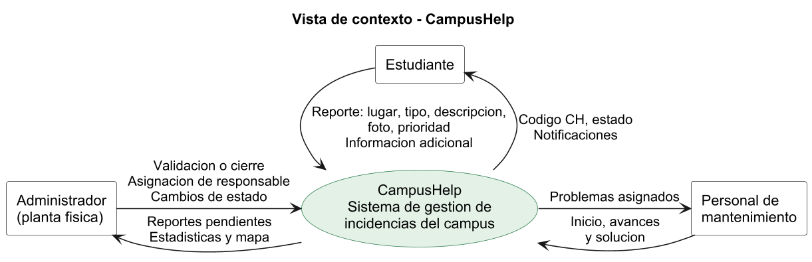
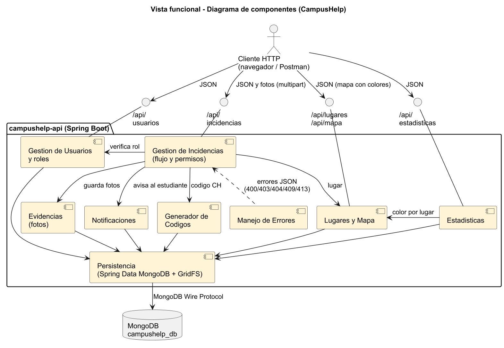
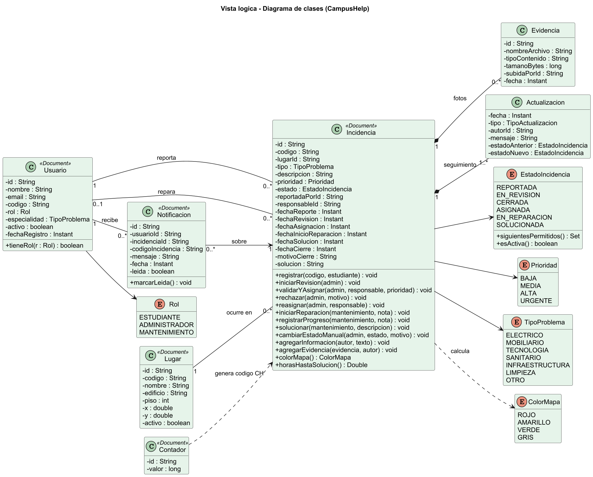
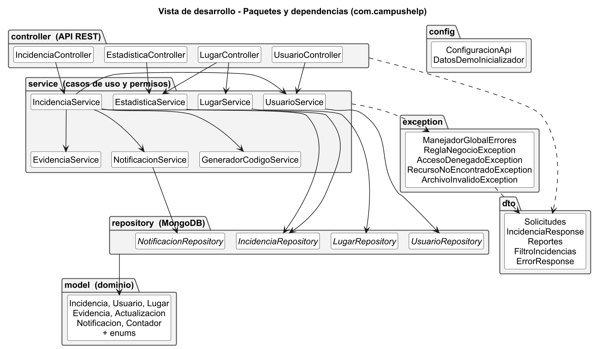
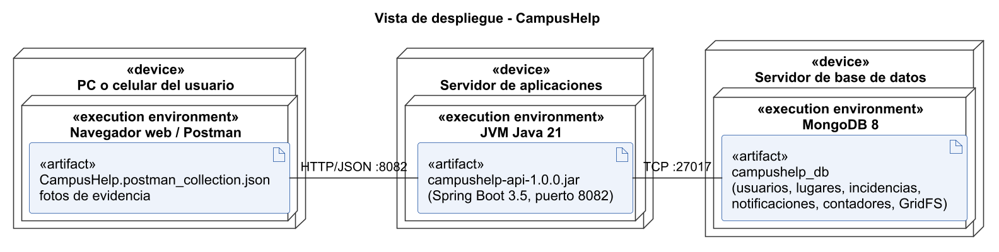

# CampusHelp: gestión de incidencias del campus

Los estudiantes reportan problemas del campus (lámparas dañadas, sillas rotas, proyectores que no funcionan, baños en
mal estado). El administrador revisa cada reporte y, si es válido, lo asigna al personal de mantenimiento, que lo
repara y lo marca como solucionado. El estudiante recibe cada actualización, y un mapa del campus muestra con colores
dónde hay problemas: 🔴 urgente, 🟡 en revisión o en proceso, 🟢 solucionado.

## Contenido del repositorio

| Carpeta / archivo | Qué tiene |
|---|---|
| [`diagramas/`](diagramas) | Los 5 diagramas de diseño en PNG y en PlantUML (código fuente) |
| [`HISTORIAS-DE-USUARIO.md`](HISTORIAS-DE-USUARIO.md) | 25 historias de usuario en 8 épicas, con criterios de aceptación |
| [`campushelp-api/`](campushelp-api) | API REST en Java 21 + Spring Boot 3.5 + MongoDB, con pruebas y colección de Postman |

## Diagramas

| Vista | Diagrama | Archivo |
|---|---|---|
| Contexto | Diagrama de contexto (actores y sistema) | [vista-contexto.png](diagramas/png/vista-contexto.png) |
| Funcional | Diagrama de componentes | [vista-funcional.png](diagramas/png/vista-funcional.png) |
| Lógica | Diagrama de clases | [vista-logica.png](diagramas/png/vista-logica.png) |
| Desarrollo | Diagrama de paquetes | [vista-desarrollo.png](diagramas/png/vista-desarrollo.png) |
| Despliegue | Diagrama de despliegue | [vista-despliegue.png](diagramas/png/vista-despliegue.png) |

También están en Visual Paradigm Online como "CampusHelp 1 - Vista de contexto" … "CampusHelp 5 - Vista de despliegue".

### Vista de contexto


### Vista funcional (componentes)


### Vista lógica (clases)


### Vista de desarrollo (paquetes)


### Vista de despliegue


## Roles

| Rol | Puede |
|---|---|
| **Estudiante** | Reportar problemas con foto, consultar sus reportes, agregar información, ver notificaciones y el mapa |
| **Administrador** | Revisar, validar o cerrar reportes, asignar y reasignar responsables, registrar lugares, ver estadísticas |
| **Mantenimiento** | Ver sus problemas asignados, iniciar la reparación, registrar avances y marcarlos como solucionados |

## Cómo ejecutar la API

Requisitos: JDK 21, Maven 3.9 y MongoDB en `mongodb://localhost:27017` (o Atlas con la variable `MONGODB_URI`).

```bash
cd campushelp-api
mvn spring-boot:run
```

- API: <http://localhost:8082>
- Swagger: <http://localhost:8082/swagger-ui.html>
- Pruebas: `mvn test` (7 pruebas: flujo por rol, permisos, fotos, mapa y estadísticas)
- Postman: importar `campushelp-api/postman/CampusHelp.postman_collection.json` y ejecutar las carpetas en orden.

La primera vez carga datos de demostración (usuarios de los 3 roles, 11 lugares y 13 reportes en todos los estados).
Los endpoints y los detalles están en el [README de la API](campushelp-api/README.md).
